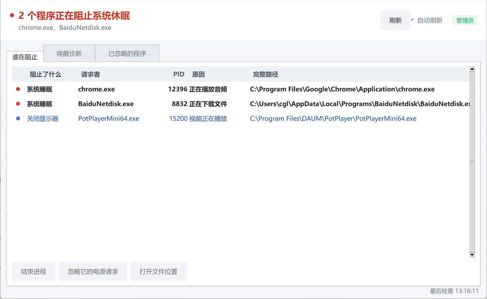

# 谁在阻止休眠 · who-blocks-sleep

[](https://github.com/yc-2018/who-blocks-sleep/releases/latest)


> 一个 Windows 小工具：查清楚是哪个程序在阻止电脑休眠 / 关屏，然后一键结束它。

Windows 的「电源和睡眠」设置看起来一切正常，电脑却整夜不睡、电池悄悄耗光。系统其实记录了每个程序发出的**电源请求（Power Request）**，只是把这些信息藏在 `powercfg` 的命令行输出里，还得管理员权限才看得到。

这个工具把那份输出变成一张能读懂的表格，并且让你直接就地处决问题进程。



## 功能

**「谁在阻止」**

- 实时列出所有生效中的电源请求，每 3 秒自动刷新
- 每行显示：阻止了哪类行为、请求进程名、PID、原因、完整路径
- 顶栏一句话概括，例如「2 个程序正在阻止系统睡眠：chrome、Everything」
- 选中后三种处理方式：

| 操作 | 说明 |
| --- | --- |
| **结束进程** | `OpenProcess` + `TerminateProcess` 强杀，失败自动回退到 `taskkill /F`；执行前弹确认框并列出 PID |
| **忽略它的电源请求** | 不杀进程，用 `powercfg /requestsoverride` 让系统从此无视它的请求。可撤销，适合正在同步网盘或播视频的程序 |
| **打开文件位置** | 在资源管理器中定位到该 exe |

**「唤醒诊断」** —— 处理「没人阻止，但电脑半夜自己醒了」的情况：唤醒定时器、上次唤醒来源、可唤醒设备、支持的睡眠状态，以及一键生成系统睡眠诊断报告。

**「已忽略的程序」** —— 随时撤销之前做过的忽略设置。

## 下载与运行

从 [Releases](https://github.com/yc-2018/who-blocks-sleep/releases/latest) 下载 `who-blocks-sleep.exe`，双击运行。

单文件、免安装、无需 Python 环境。**启动时会弹出 UAC 确认，必须点「是」**——非管理员读不到电源请求的详细信息。

## 从源码运行

只需要 Python 3.8+ 和标准库，没有任何第三方依赖：

```bash
python src/who_blocks_sleep.py
```

## 重新打包

本机需要 Python 3.8+ 与 PyInstaller：

```bash
pip install pyinstaller
build.bat
```

> **注意**：`assets/app.manifest` 同时声明了两件事——管理员权限和 DPI 感知。必须把它和 `--uac-admin` 一起传给 PyInstaller：单独用 `--manifest` 时，PyInstaller 会把清单里的 `requestedExecutionLevel` 重置成 `asInvoker`，导致程序不再提权。而缺少 DPI 声明时，高缩放屏幕（如 200%）上 Windows 会把整个界面当作位图拉伸两倍，文字发虚、显小。

## 工作原理

核心只有一条命令：

```
powercfg /requests
```

它返回 `DISPLAY` / `SYSTEM` / `AWAYMODE` 等几类请求，每类下是发起请求的进程设备路径。程序解析这些输出，再用 `CreateToolhelp32Snapshot` 建立「设备路径 → PID / 进程名」的映射，把结果渲染到表格里。

结束进程走 Win32 API，忽略请求走 `powercfg /requestsoverride`，两条路都不依赖第三方组件。

## 已知限制

- **只能看到「正在生效」的请求。** 程序申请过但已经自行释放的请求，`powercfg` 不保留记录。所以列表为空而电脑仍然不睡时，去「唤醒诊断」页查定时器和可唤醒设备。
- **电源请求只是现代待机（S0 低电量待机）判定逻辑的一部分。** 设备驱动、系统服务、组策略都可能单独阻止睡眠。
- 部分系统级请求（如 `SYSTEM` 类的「正在播放音频」）来自驱动或内核组件，强制结束对应进程可能导致音频中断，请确认后再操作。

## 目录结构

```
.
├── src/
│   ├── who_blocks_sleep.py    # 主程序，单文件
│   └── make_icon.py           # 生成应用图标
├── assets/
│   ├── app.ico                # 程序图标
│   ├── app.png                # 图标源图
│   └── app.manifest           # 提权 + DPI 感知声明
├── build.bat                  # 一键打包
└── preview.png                # 界面截图
```

## License

[MIT](LICENSE)
